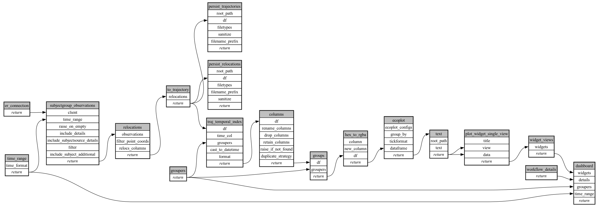

```
# AUTOGENERATED BY ECOSCOPE-WORKFLOWS; see fingerprint in README.md for details

```

```yaml
# fingerprint:
artifacts_sha256_basic: 4807d88814354c578c77e19d3e4c3852d8a5dbdc22904b22ba3874188214e60b
artifacts_sha256_strict: b5c6d711c1690d369389ce1f77b1f98e56cdb7966cf2ed7a81b28ec1ea0fb115
installed_requirements:
- channel: https://repo.prefix.dev/ecoscope-workflows/
  name: ecoscope-platform
  version: {version: ==2.25.3}
- channel: https://repo.prefix.dev/ecoscope-workflows-custom/
  name: ecoscope-workflows-ext-custom
  version: {version: ==0.1.4}
- channel: https://repo.prefix.dev/ecoscope-workflows-custom/
  name: ecoscope-workflows-ext-ste
  version: {version: ==0.0.34}
- channel: conda-forge
  name: pydeck
  version: {version: ==0.9.2}
params_sha256: b755f5e5876df8d41174a71f06ec2bfe4dc81f299c097946eaae271e1cf25ad6
spec_sha256: aa71f3f79cc151fbd7dbf4fbcdbf9f4fd95d575e1acc9a6ab27f0e29b37516f4

```

# ecoscope-workflows-subject-nsd-plot-workflow


