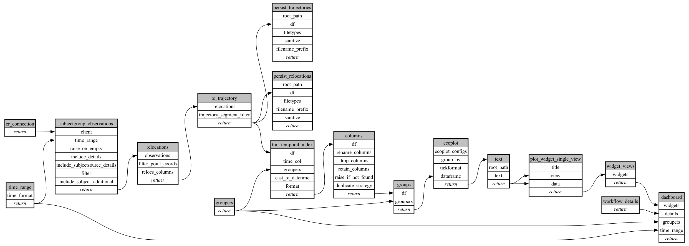

```
# AUTOGENERATED BY ECOSCOPE-WORKFLOWS; see fingerprint in README.md for details

```

```yaml
# fingerprint:
artifacts_sha256_basic: 096c67b8bad6ab9995ba6cb617cf67f44f18658fded6d1b5a159b7fae3168199
artifacts_sha256_strict: 5315dd1a20fb6932ebbf50fed1dbf2880ff8296bbc606e5c25fe7531dd7d8186
installed_requirements:
- channel: https://repo.prefix.dev/ecoscope-workflows/
  name: ecoscope-platform
  version: {version: ==2.25.3}
- channel: https://repo.prefix.dev/ecoscope-workflows-custom/
  name: ecoscope-workflows-ext-mep
  version: {version: ==1.0.8}
- channel: https://repo.prefix.dev/ecoscope-workflows-custom/
  name: ecoscope-workflows-ext-ste
  version: {version: ==0.0.0rc1}
- channel: https://repo.prefix.dev/ecoscope-workflows-custom/
  name: ecoscope-workflows-ext-custom
  version: {version: ==0.1.0rc14}
- channel: conda-forge
  name: pydeck
  version: {version: ==0.9.2}
params_sha256: cc23814a2df67e471e66a596820136569b1f8364312e1d9dbfa5b00236e1bfdb
spec_sha256: b0911b84ed0fd4bf67c11c4ac82df2c66d0bf7eb5afc884bd7a1c0ba43e44f12

```

# ecoscope-workflows-subject-nsd-plot-workflow


